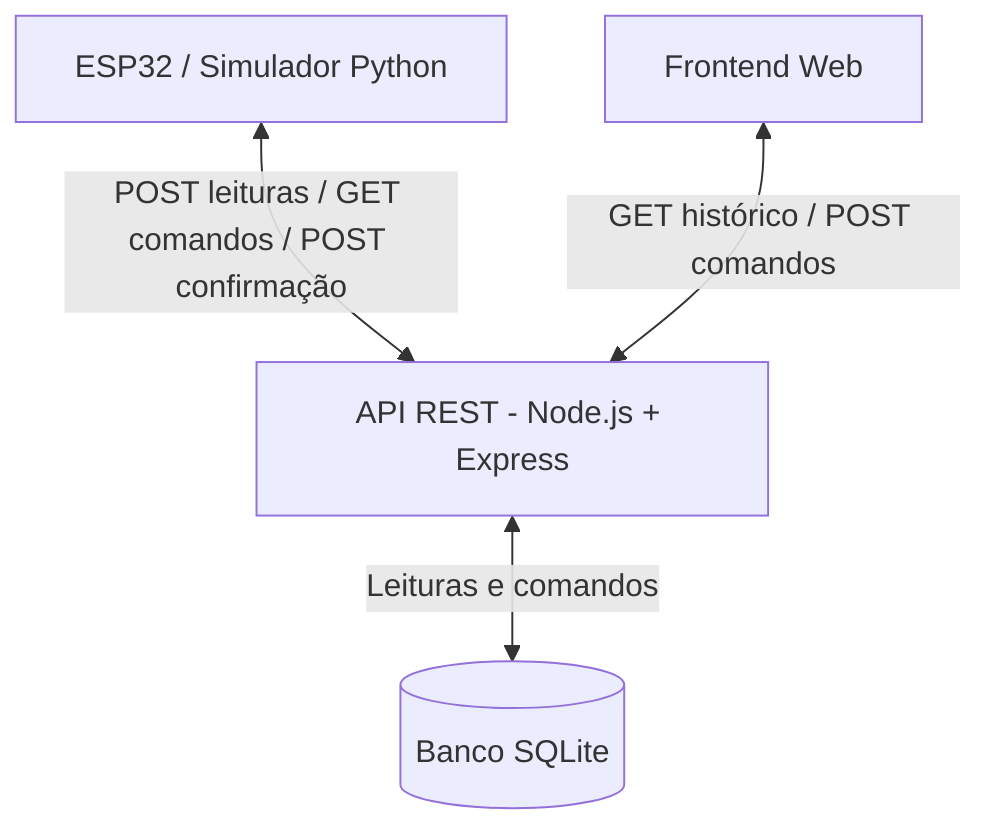
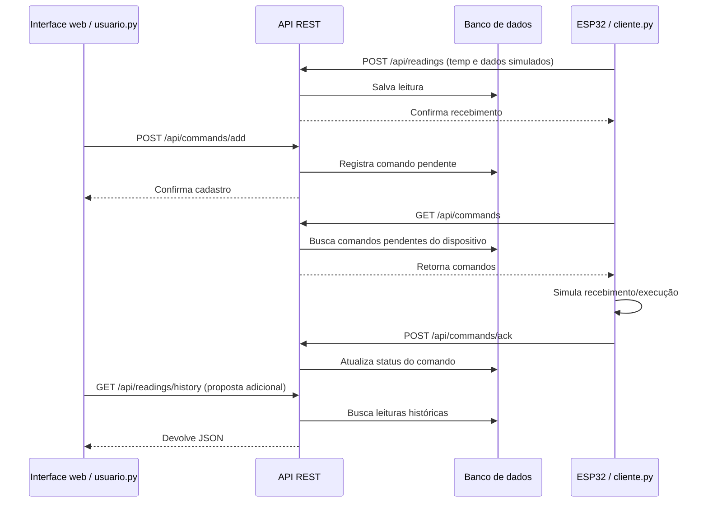

# Atividade 01 — Definição do projeto e arquitetura do sistema

## 1. Identificação e objetivo

**Projeto:** Sistema Web para Controle Remoto e Monitoramento em Tempo Real de um Soprador Térmico via ESP32.

O sistema proposto permitirá acompanhar medições de temperatura de um soprador térmico e enviar comandos por uma interface web. O ESP32 será responsável pela aquisição de dados e, em uma etapa futura, pela atuação no equipamento. Nesta primeira atividade, são definidos apenas a arquitetura, o repositório, os contratos de comunicação e o fluxo de dados; **não se afirma que a aplicação já foi implementada ou testada**.

## 2. Arquitetura geral proposta

| Módulo | Tecnologia proposta | Responsabilidade |
|---|---|---|
| Dispositivo | ESP32 (simulado inicialmente em Python) | Enviar medições periodicamente, consultar comandos e confirmar recebimento/execução simulada |
| Backend | Python + Node.js + Express | Expor API REST, validar requisições e persistir leituras e comandos |
| Banco | SQLite no protótipo | Armazenar dispositivos, leituras e histórico/status de comandos |
| Frontend | HTML, CSS e JavaScript | Exibir temperatura, histórico e formulário para envio de comandos |
| Comunicação | HTTP + JSON e token Bearer | Integração entre os módulos, com autenticação a especificar e configurar |

O exemplo do professor usa os campos `temp` e `nivel`. Para o soprador térmico, **a temperatura é a variável de interesse confirmada pelo tema**, enquanto `nivel` será mantido somente como campo de simulação de exemplo até que sejam definidos os sensores reais. O comando `setpoint` é também uma proposta de contrato para teste; ainda não corresponde à atuação física implementada.

### Diagrama da arquitetura



## 3. Repositório e organização

O repositório Git já está inicializado no material fornecido. Sua organização existente deve ser mantida:

```text
Projeto-Integrador/
├── backend/          # implementação futura da API
├── frontend/         # implementação futura da interface
├── esp32/
│   └── simulation/   # scripts Python de simulação, em etapa posterior
├── docs/
│   ├── ATIVIDADE_01.md
│   └── API_CONTRATO.md
├── .gitignore
└── README.md
```

Pastas vazias podem não aparecer no GitHub porque o Git não registra diretórios sem arquivos. Se necessário, poderão ser incluídos arquivos `.gitkeep`, sem antecipar a implementação das próximas atividades.

## 4. Endpoints e dados

As rotas básicas seguem o simulador Python apresentado em aula. Consulte [API_CONTRATO.md](API_CONTRATO.md) para métodos, exemplos JSON, códigos de resposta e observações de segurança.

## 5. Diagrama de fluxo de dados



## 6. Limites desta entrega

Esta atividade contém especificação e organização do projeto. **Não inclui** API em execução, banco populado, dashboard funcional, nem controle real do soprador térmico. Comandos que possam alterar a temperatura de um aparelho real devem ser avaliados com limites, intertravamentos e mecanismos de desligamento seguro antes de qualquer implementação física.
